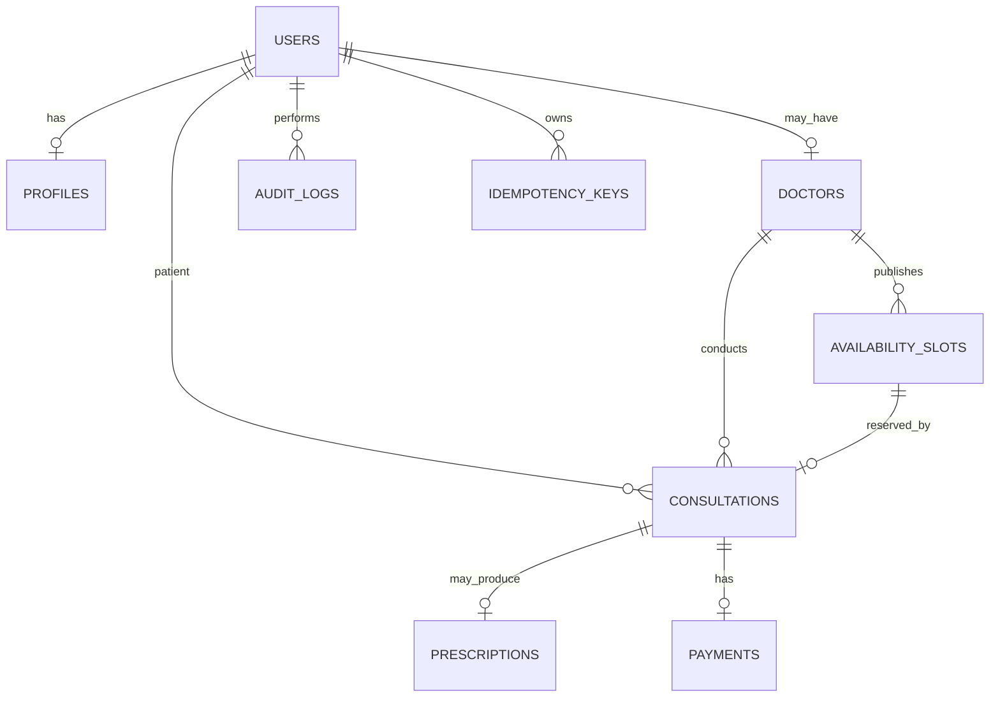

# ER diagram

`users.mfa_secret_enc` and `users.mfa_pending_secret_enc` contain AES-256-GCM encrypted TOTP seeds; `mfa_enabled` gates login for doctors and admins. Audit metadata must not contain credentials, OTPs, or prescription contents.
